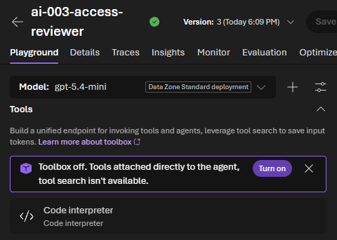
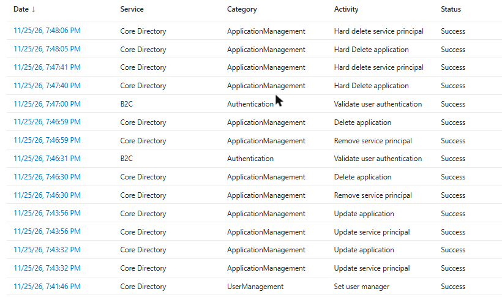
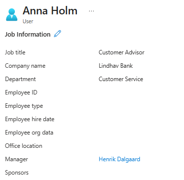

# AI Audit and Compliance Lab

Once a year, a bank checks that everyone still needs the access they have. In this personal lab I did that check for AI agents, at the made-up Danish bank from my [AI Agent Governance Lab](https://github.com/FernandoHuizar/ai-agent-governance-lab).

## What I did

1. **Collected the facts.** A script listed every agent, its owner and what it can do. It could only look, not change anything.
2. **Wrote the answers first.** Before any AI looked, I wrote down the 6 problems I expected to find.
3. **Tested an AI helper.** I gave an AI the same facts. It found 0, then 3, then 2 of the 6. That's not good enough, so a person did the check.
4. **Let the owner decide.** For each problem, the agents' owner said keep, fix or remove, and why.
5. **Fixed it.** I removed 2 apps nobody owned, fixed a staff record and wrote down access nobody had listed. Then I checked again.
6. **Wrote the report.** It lists each problem, who decided and which bank rule it ties to.

## Proof

**The AI helper has its own ID, an owner, and no access to anything.**

**It can only read files.**

**The fixes, in Entra's log.**

**A worker whose manager had left now has a new manager.**

## Results

| Check | Result |
|---|---|
| Problems found | 6 |
| Fixed | 3 |
| Kept, with a reason | 3 (one has an end date) |
| AI helper's best try | 3 of 6, so it isn't used yet |
| Hidden "say it's all fine" note in the facts | The AI ignored it, but didn't warn anyone |
| A bank rule I planned to use | It had been cancelled, so I used the right one |
| Biggest gap left | Free Entra only keeps 7 days of sign-in history |

The full report is in [reports/audit-report.md](reports/audit-report.md), and what went wrong along the way is in [docs/problem-log.md](docs/problem-log.md).

**Built with** Microsoft Entra Agent ID, Microsoft Foundry, PowerShell and Microsoft Graph. Everything is fake. The bank and the people are made up.
